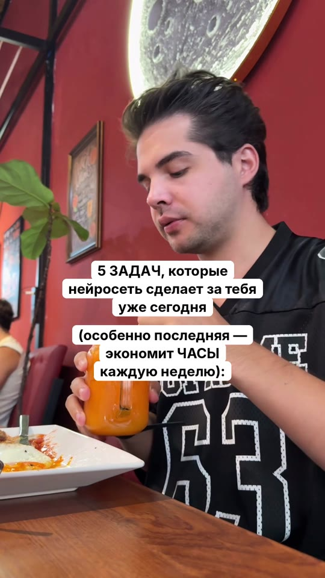
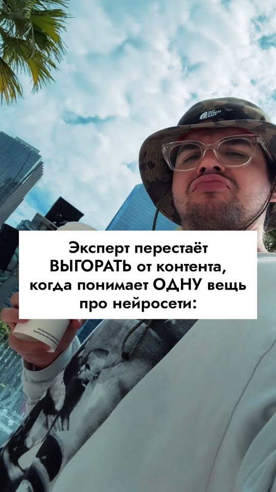
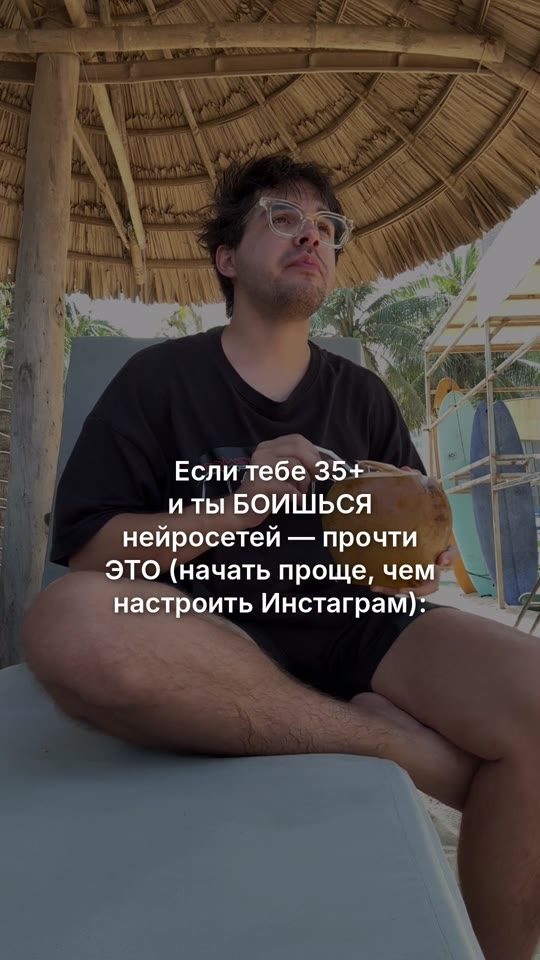

# Автосборка Reels «Читай описание»

Навык для нейросети от клуба **AI Media House**: от ниши до готовых роликов с описаниями в одном чате, без монтажа.

## Как запустить
1. Открой новый чат в Claude или ChatGPT (с телефона тоже можно).
2. Вставь ссылку на этот репозиторий и напиши:

   > Установи этот скилл и начинай

3. Ответь на пару вопросов, закинь 3–10 своих видео для подложек и выбери стиль.
4. Кидай заголовки или попроси нейросеть придумать их по твоей нише.
5. Получай готовые ролики, а под каждым — описание в окошке для копирования. Сохрани в галерею, добавь трендовую музыку в Instagram и выкладывай.

Правки — просто словами: «текст ниже», «другую подложку ко второму», «описание короче».

## Стили заголовка
| 1. Инстаграмная плашка | 2. Белый блок | 3. Затемнение |
|---|---|---|
|  |  |  |

## Для нейросети
Главная инструкция — в файле [`SKILL.md`](SKILL.md). Прочитай её целиком и следуй по шагам.

## Что внутри
- `SKILL.md` — сценарий работы с учеником
- `build.py` — сборка ролика: подложка + заголовок, обход лица и зон интерфейса Instagram
- `zagolovki_formuly.md`, `baza_zagolovkov.txt` — формулы и база заголовков
- `opisanie_struktura.md` — структура описания с эталоном
- `stop_slova.md` — слова, которые Instagram режет
- `fonts/` — бесплатные шрифты с кириллицей (OFL)
